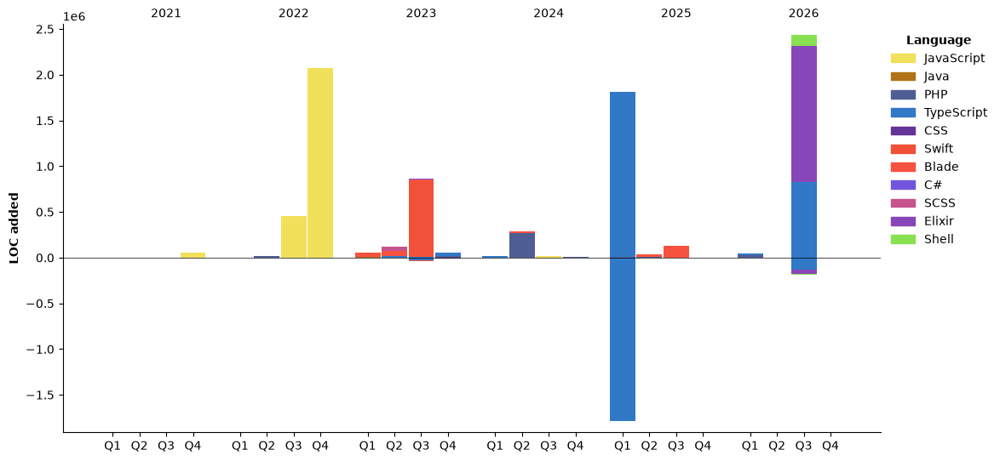

<!--START_SECTION:waka-->


**🐱 My GitHub Data** 

> 📦 232.4 kB Used in GitHub's Storage 
 > 
> 🏆 379 Contributions in the Year 2026
 > 
> 🚫 Not Opted to Hire
 > 
> 📜 28 Public Repositories 
 > 
> 🔑 13 Private Repositories 
 > 
**I'm a Night 🦉** 

```text
🌞 Morning                749 commits         ██░░░░░░░░░░░░░░░░░░░░░░░   09.81 % 
🌆 Daytime                2755 commits        █████████░░░░░░░░░░░░░░░░   36.09 % 
🌃 Evening                4009 commits        █████████████░░░░░░░░░░░░   52.52 % 
🌙 Night                  120 commits         ░░░░░░░░░░░░░░░░░░░░░░░░░   01.57 % 
```
📅 **I'm Most Productive on Saturday** 

```text
Monday                   137 commits         ░░░░░░░░░░░░░░░░░░░░░░░░░   01.79 % 
Tuesday                  1086 commits        ████░░░░░░░░░░░░░░░░░░░░░   14.23 % 
Wednesday                441 commits         █░░░░░░░░░░░░░░░░░░░░░░░░   05.78 % 
Thursday                 1585 commits        █████░░░░░░░░░░░░░░░░░░░░   20.77 % 
Friday                   1501 commits        █████░░░░░░░░░░░░░░░░░░░░   19.66 % 
Saturday                 1681 commits        ██████░░░░░░░░░░░░░░░░░░░   22.02 % 
Sunday                   1202 commits        ████░░░░░░░░░░░░░░░░░░░░░   15.75 % 
```


📊 **This Week I Spent My Time On** 

```text
🕑︎ Time Zone: Asia/Jakarta

💬 Programming Languages: 
Markdown                 10 hrs 28 mins      ██████████░░░░░░░░░░░░░░░   40.78 % 
PHP                      7 hrs 46 mins       ████████░░░░░░░░░░░░░░░░░   30.26 % 
HTML                     2 hrs 37 mins       ███░░░░░░░░░░░░░░░░░░░░░░   10.19 % 
TypeScript               1 hr 50 mins        ██░░░░░░░░░░░░░░░░░░░░░░░   07.18 % 
Text                     39 mins             █░░░░░░░░░░░░░░░░░░░░░░░░   02.57 % 

🔥 Editors: 
Claude Code              25 hrs 29 mins      █████████████████████████   99.26 % 
VS Code                  11 mins             ░░░░░░░░░░░░░░░░░░░░░░░░░   00.74 % 

🐱‍💻 Projects: 
api.propelyourbusiness.co13 hrs 38 mins      █████████████░░░░░░░░░░░░   53.14 % 
khs-backend              9 hrs 56 mins       ██████████░░░░░░░░░░░░░░░   38.71 % 
app.propelyourbusiness.co1 hr 40 mins        ██░░░░░░░░░░░░░░░░░░░░░░░   06.54 % 
www                      22 mins             ░░░░░░░░░░░░░░░░░░░░░░░░░   01.49 % 
khs-presentation         1 min               ░░░░░░░░░░░░░░░░░░░░░░░░░   00.11 % 

💻 Operating System: 
Mac                      25 hrs 40 mins      █████████████████████████   100.00 % 
```

🤖 **AI Coding This Week** 

```text
⏱ AI Coding Time: 25 hrs 34 mins (99.62%)

✍️ 14,692 lines written by AI, 6 lines written by hand (99.96% AI-written)

🔤 16,883,519 Input Tokens, 3,716,812 Output Tokens

💵 $425.01 Estimated AI Cost This Week

🧠 35 AI Sessions, 310 AI Prompts

Opus                     15,589 lines        █████████████████████████   100.00 % 
Sonnet                   0 lines             ░░░░░░░░░░░░░░░░░░░░░░░░░   00.00 % 

🔎 AI Coding Insights:
🤖 AI-Driven — 99.96% of written lines came from AI
📚 Verbose Prompter — average 2,406 characters per prompt
🔁 Iterative Prompter — average 9 prompts per session
🚀 High AI Trust — 0.04% of changed lines were hand-edited
```

**I Mostly Code in PHP** 

```text
PHP                      14 repos            ███████░░░░░░░░░░░░░░░░░░   29.17 % 
TypeScript               11 repos            ██████░░░░░░░░░░░░░░░░░░░   22.92 % 
Blade                    6 repos             ███░░░░░░░░░░░░░░░░░░░░░░   12.50 % 
Elixir                   1 repo              █░░░░░░░░░░░░░░░░░░░░░░░░   02.08 % 
Shell                    1 repo              █░░░░░░░░░░░░░░░░░░░░░░░░   02.08 % 
```


**Timeline**




<!--END_SECTION:waka-->
