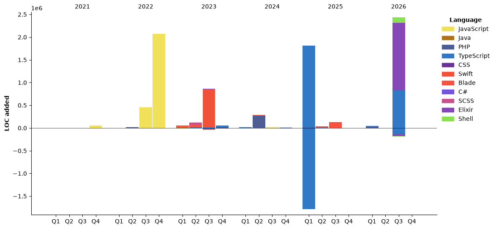

<!--START_SECTION:waka-->


**🐱 My GitHub Data** 

> 📦 232.6 kB Used in GitHub's Storage 
 > 
> 🏆 383 Contributions in the Year 2026
 > 
> 🚫 Not Opted to Hire
 > 
> 📜 29 Public Repositories 
 > 
> 🔑 13 Private Repositories 
 > 
**I'm a Night 🦉** 

```text
🌞 Morning                749 commits         ██░░░░░░░░░░░░░░░░░░░░░░░   09.68 % 
🌆 Daytime                2781 commits        █████████░░░░░░░░░░░░░░░░   35.94 % 
🌃 Evening                4086 commits        █████████████░░░░░░░░░░░░   52.81 % 
🌙 Night                  121 commits         ░░░░░░░░░░░░░░░░░░░░░░░░░   01.56 % 
```
📅 **I'm Most Productive on Saturday** 

```text
Monday                   137 commits         ░░░░░░░░░░░░░░░░░░░░░░░░░   01.77 % 
Tuesday                  1114 commits        ████░░░░░░░░░░░░░░░░░░░░░   14.40 % 
Wednesday                443 commits         █░░░░░░░░░░░░░░░░░░░░░░░░   05.73 % 
Thursday                 1586 commits        █████░░░░░░░░░░░░░░░░░░░░   20.50 % 
Friday                   1532 commits        █████░░░░░░░░░░░░░░░░░░░░   19.80 % 
Saturday                 1687 commits        █████░░░░░░░░░░░░░░░░░░░░   21.80 % 
Sunday                   1238 commits        ████░░░░░░░░░░░░░░░░░░░░░   16.00 % 
```


📊 **This Week I Spent My Time On** 

```text
🕑︎ Time Zone: Asia/Jakarta

💬 Programming Languages: 
Markdown                 9 hrs 24 mins       ██████████░░░░░░░░░░░░░░░   41.24 % 
PHP                      5 hrs 58 mins       ███████░░░░░░░░░░░░░░░░░░   26.20 % 
HTML                     3 hrs 22 mins       ████░░░░░░░░░░░░░░░░░░░░░   14.78 % 
Other                    1 hr 6 mins         █░░░░░░░░░░░░░░░░░░░░░░░░   04.82 % 
TypeScript               1 hr 3 mins         █░░░░░░░░░░░░░░░░░░░░░░░░   04.64 % 

🔥 Editors: 
Claude Code              22 hrs 44 mins      █████████████████████████   99.72 % 
VS Code                  3 mins              ░░░░░░░░░░░░░░░░░░░░░░░░░   00.28 % 

🐱‍💻 Projects: 
api.propelyourbusiness.co14 hrs 32 mins      ████████████████░░░░░░░░░   63.74 % 
khs-backend              7 hrs 16 mins       ████████░░░░░░░░░░░░░░░░░   31.90 % 
www                      24 mins             ░░░░░░░░░░░░░░░░░░░░░░░░░   01.78 % 
app.propelyourbusiness.co20 mins             ░░░░░░░░░░░░░░░░░░░░░░░░░   01.51 % 
infra-propelyourbusiness 14 mins             ░░░░░░░░░░░░░░░░░░░░░░░░░   01.08 % 

💻 Operating System: 
Mac                      22 hrs 48 mins      █████████████████████████   100.00 % 
```

🤖 **AI Coding This Week** 

```text
⏱ AI Coding Time: 22 hrs 46 mins (99.86%)

✍️ 11,245 lines written by AI, 1 lines written by hand (99.99% AI-written)

🔤 14,590,186 Input Tokens, 3,161,814 Output Tokens

💵 $339.12 Estimated AI Cost This Week

🧠 30 AI Sessions, 290 AI Prompts

Opus                     12,028 lines        █████████████████████████   100.00 % 
Haiku                    0 lines             ░░░░░░░░░░░░░░░░░░░░░░░░░   00.00 % 

🔎 AI Coding Insights:
🤖 AI-Driven — 99.99% of written lines came from AI
📚 Verbose Prompter — average 2,847 characters per prompt
🔁 Iterative Prompter — average 10 prompts per session
🚀 High AI Trust — 0.01% of changed lines were hand-edited
```

**I Mostly Code in PHP** 

```text
PHP                      15 repos            ████████░░░░░░░░░░░░░░░░░   30.61 % 
TypeScript               11 repos            ██████░░░░░░░░░░░░░░░░░░░   22.45 % 
Blade                    6 repos             ███░░░░░░░░░░░░░░░░░░░░░░   12.24 % 
Elixir                   1 repo              █░░░░░░░░░░░░░░░░░░░░░░░░   02.04 % 
Shell                    1 repo              █░░░░░░░░░░░░░░░░░░░░░░░░   02.04 % 
```


**Timeline**




<!--END_SECTION:waka-->
